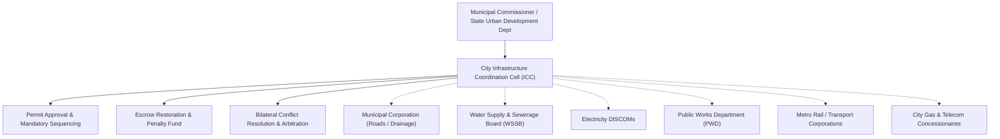

# CitySync — Unified Digital Platform for Inter-Departmental Cooperation & Citizen Grievance Redressal

<p align="center">
  
  
  
  
  
  
  
  
  
  
</p>

> **"One Platform. One City. No More Digging in the Dark."**  
> *A state-of-the-art civic intelligence ecosystem combining an Inter-Departmental Infrastructure Coordination Platform with an official Citizen Grievance & Civic Redressal Portal to end the chronic "dig–repair–dig" cycle across modern smart cities.*

---

## 📑 Table of Contents

1. [Urban Problem Statement & The Chronic Digging Crisis](#-urban-problem-statement)
2. [The CitySync Solution: Dual-Portal Ecosystem](#-the-citysync-solution-dual-portal-ecosystem)
3. [Key Stakeholders & Implementing Agencies](#-key-stakeholders--implementing-agencies)
4. [Ecosystem Architecture & Data Flow](#-ecosystem-architecture--data-flow)
5. [Core Platform 1: Inter-Departmental Coordination Portal](#-core-platform-1-inter-departmental-coordination-portal)
   - [GIS Spatial Registry & Geotagged Projects](#1-gis-spatial-registry--geotagged-projects)
   - [Algorithmic Conflict Detection Engine (Haversine & Temporal)](#2-algorithmic-conflict-detection-engine)
   - [Master City Scheduling & Unified Gantt Timeline](#3-master-city-scheduling--unified-gantt-timeline)
   - [Cross-Department Resource & Equipment Sharing](#4-cross-department-resource--equipment-sharing)
   - [Project Milestones & Task Progress Tracking](#5-project-milestones--task-progress-tracking)
   - [Machine Learning Delay & Risk Prediction](#6-machine-learning-delay--risk-prediction)
   - [Multi-Tier Role-Based Access Control (RBAC)](#7-multi-tier-role-based-access-control-rbac)
   - [Real-Time Collision Alerts & Immutable Audit Trail](#8-real-time-collision-alerts--immutable-audit-trail)
6. [Core Platform 2: CitySyncPublic — Citizen Grievance Portal](#-core-platform-2-citysyncpublic--citizen-grievance-portal)
   - [Geo-Tagged Photo Reporting & Pin-Drop Map Picker](#1-geo-tagged-photo-reporting--pin-drop-map-picker)
   - [Public Civic Transparency Map (`/map`)](#2-public-civic-transparency-map-map)
   - [Before & After Resolution Verification](#3-before--after-resolution-verification)
   - [Satisfaction Ratings (1-5 Stars) & Re-Open Workflow](#4-satisfaction-ratings-1-5-stars--re-open-workflow)
   - ["I Am Also Facing This" Community Upvoting (+1)](#5-i-am-also-facing-this-community-upvoting-1)
   - [Dynamic SLA Clocks & Overdue Breach Indicators](#6-dynamic-sla-clocks--overdue-breach-indicators)
   - [In-Portal Notification Center & Profile Management](#7-in-portal-notification-center--profile-management)
   - [Self-Service Password Recovery with 6-Digit OTP](#8-self-service-password-recovery-with-6-digit-otp)
7. [Bilingual Support & Institutional Zero-Blue Design](#-bilingual-support--institutional-zero-blue-design)
8. [Technology Stack](#-technology-stack)
9. [Repository Directory Structure](#-repository-directory-structure)
10. [Quickstart & Installation Guide](#-quickstart--installation-guide)
11. [Pre-Seeded Demo Accounts & Credentials](#-pre-seeded-demo-accounts--credentials)
12. [Complete REST API Reference](#-complete-rest-api-reference)
    - [Inter-Departmental Platform APIs (Port 5000)](#inter-departmental-platform-apis-port-5000)
    - [CitySyncPublic Citizen APIs (Port 5001)](#citysyncpublic-citizen-apis-port-5001)
13. [Role & Permissions Matrix](#-role--permissions-matrix)
14. [The 5-Part "Dig-Later" Policy Framework](#-the-5-part-dig-later-policy-framework)
15. [Statutory Governance & Institutional Model](#-statutory-governance--institutional-model)
16. [Capstone Team Roles & Module Distribution](#-capstone-team-roles--module-distribution)
17. [Git Collaboration & Branching Strategy](#-git-collaboration--branching-strategy)
18. [License & Academic Attribution](#-license--academic-attribution)

---

## 🏙️ Urban Problem Statement

Modern municipal governance is characterized by extreme administrative fragmentation. Line departments and utility concessionaires—including the Public Works Department (PWD), Water Supply & Sewerage Board (WSSB), Electricity Distribution Companies (DISCOMs), City Gas Utilities, Metro Rail Corporations, and Telecom Operators—plan, budget, and execute capital civil works inside departmental silos without shared spatial visibility.

This structural disconnect triggers the chronic **"dig–repair–dig" cycle** that plagues urban centers:

```
[1. Municipal PWD]       ────> Lays fresh bituminous asphalt on an arterial road (₹1.5 Crore budget)
           │
           ▼ (60 days later)
[2. City Gas Utility]    ────> Trench-cuts fresh road to lay underground natural gas pipes
           │
           ▼ (90 days later)
[3. Water Board (WSSB)]  ────> Excavates the same road corridor to replace a ruptured trunk sewer main
           │
           ▼ (45 days later)
[4. Electricity DISCOM]  ────> Micro-trenches across the pavement to install high-tension underground feeder cables
           │
           ▼
[Crisis Outcome]         ────> Road structural integrity is destroyed, crater-sized potholes proliferate,
                               taxpayer funds are squandered repeatedly, and traffic gridlock paralyzes the city.
```

### Quantifiable Damages of Uncoordinated Road Excavations:
* **Taxpayer Waste:** Billions in municipal revenues are lost annually resurfacing asphalt roadways that are destroyed within weeks by neighboring utilities.
* **Economic & Productivity Losses:** Repeated trenching generates severe vehicular congestion, supply-chain delays, public transit detours, and commercial disruption.
* **Public Health Hazards & Air Pollution:** Continuous unpaved dirt trenches and debris elevate airborne particulate matter ($\text{PM}_{2.5}$ and $\text{PM}_{10}$), triggering respiratory illnesses.
* **Severe Infrastructure Damage & Outages:** Heavy backhoes and excavators from one agency regularly slice optical fiber backbones, puncture pressurized water trunks, or sever power lines due to zero sub-surface visibility.
* **Citizen Frustration & Low Trust:** Citizens have no transparent channel to track why roads are repeatedly destroyed or hold contractors accountable for delayed restoration.

---

## 💡 The CitySync Solution: Dual-Portal Ecosystem

**CitySync** delivers a unified, digital-first municipal coordination and public transparency ecosystem structured into two seamlessly integrated platforms:

```mermaid
flowchart TD
    subgraph CitySync Ecosystem
        subgraph Portal 1: Municipal Staff & Admin Portal [Port 5173 / Port 5000]
            StaffUI["React 18 Municipal Coordination Dashboard"]
            StaffAuth["RBAC: City Admin, Department Heads, Field Officers"]
            ConflictEngine["Haversine Spatial & Temporal Conflict Engine"]
            MasterGantt["Unified Multi-Agency Gantt Timeline & Sequencing"]
            MachineryPool["Cross-Department Heavy Machinery Pool"]
            MilestoneTracker["Project Milestones & Task Progress Engine"]
            AuditTrail["Immutable Audit Logger & Real-time Alerts"]
        end

        subgraph Portal 2: CitySyncPublic — Citizen Grievance Portal [Port 5174 / Port 5001]
            CitizenUI["Bilingual Citizen Portal (English & हिन्दी)"]
            CitizenAuth["Citizen Registration, JWT & 6-Digit OTP Recovery"]
            GISPublicMap["Interactive Civic Transparency Map (/map)"]
            PinDropMap["Pin-Drop Map Picker (Leaflet & GPS Auto-Pin)"]
            BeforeAfter["Before & After Photo Resolution Verification"]
            RatingsReopen["5-Star Satisfaction Ratings & Re-Open Escalations"]
            Upvoting["Community '+1 Facing This' Upvoting Engine"]
            SLATracker["Dynamic SLA Clocks & Overdue Breach Alerts"]
        end

        subgraph Shared Civic Database [MongoDB Atlas]
            ProjectsColl[("Projects & Spatial Geotags")]
            ConflictsColl[("Detected Collisions")]
            GrievancesColl[("Citizen Grievances")]
            UsersColl[("Staff & Citizen Accounts")]
            AuditColl[("System Audit Trail")]
        end

        StaffUI --> StaffAuth --> ConflictEngine & MasterGantt & MachineryPool & MilestoneTracker
        ConflictEngine & MasterGantt & MachineryPool & MilestoneTracker --> ProjectsColl & ConflictsColl
        
        CitizenUI --> CitizenAuth --> PinDropMap & GISPublicMap & BeforeAfter & RatingsReopen & Upvoting
        PinDropMap & BeforeAfter & RatingsReopen & Upvoting --> GrievancesColl
        
        GrievancesColl -.->|"Auto-routes repairs to line departments"| StaffUI
        ProjectsColl -.->|"Feeds active roadwork data"| GISPublicMap
    end
```

1. **Municipal Inter-Departmental Portal (`/frontend` on Port 5173 + `/backend` on Port 5000):**  
   An authoritative planning, conflict detection, permitting, and resource-sharing cockpit for municipal commissioners, department heads, and site engineers.
2. **CitySyncPublic Citizen Portal (`/CitySyncPublic/frontend` on Port 5174 + `/CitySyncPublic/backend` on Port 5001):**  
   A dedicated public redressal web portal empowering residents to pinpoint road hazards, upload photo evidence, monitor real-time SLA repair clocks, upvote urgent neighborhood issues, and verify repair quality.

---

## 🏛️ Key Stakeholders & Implementing Agencies

| Agency | Domain & Primary Responsibilities | Sub-Surface & Right-of-Way Impact |
|---|---|---|
| **Municipal Corporation (ULB)** | City roads, storm-water drainage networks, solid waste management, street lighting | Surface paving, open culverts, roadside gutters |
| **Water Supply & Sewerage Board (WSSB)** | Pressurized potable water trunk lines, sewer collectors, treatment facilities | Deep open-trench excavations ($1.5\text{m} - 3.5\text{m}$ depth) |
| **Electricity DISCOM** | High/low-tension feeder cables, substations, underground conduits, street transformers | Medium-depth trenches ($0.8\text{m} - 1.2\text{m}$ depth) |
| **Public Works Department (PWD)** | Transit corridors, arterial expressways, bypasses, flyovers, grade separators | Heavy pavement excavation, structural foundation piling |
| **Metro Rail / Transit Authority** | Mass rapid transit viaducts, underground tunnels, multi-modal transport hubs | Deep sub-surface tunneling, multi-year right-of-way diversions |
| **City Gas & Telecom Concessionaires** | Piped natural gas (PNG) steel pipelines, optical fiber duct networks | Horizontal directional drilling (HDD), micro-trenching |
| **Residents & Commuters** | Public reporting, local road defect monitoring, resolution verification | End users affected by road damage and traffic congestion |

---

## 🏗️ Ecosystem Architecture & Data Flow

```mermaid
sequenceDiagram
    autonumber
    actor Citizen as Citizen (CitySyncPublic)
    participant PubFront as Public Frontend (:5174)
    participant PubBack as Public Backend (:5001)
    participant DB as MongoDB Atlas
    participant StaffBack as Staff Backend (:5000)
    actor DeptHead as Department Head (PWD/WSSB)
    actor Admin as City Administrator (ICC)

    Note over Citizen,PubBack: Citizen Grievance & Civic Redressal Flow
    Citizen->>PubFront: Snaps photo of hazardous pothole & pins GPS location
    PubFront->>PubBack: POST /api/citizen/grievances/submit (Multipart + GPS)
    PubBack->>DB: Saves Grievance (assigns PWD, sets 48h SLA deadline)
    PubBack->>Citizen: Returns tracking ticket (e.g., GRV-2026-1011)

    Note over DeptHead,StaffBack: Department Project Proposal & Conflict Detection
    DeptHead->>StaffBack: Submits pipeline expansion project (lat/lng, dates, budget)
    StaffBack->>StaffBack: Runs Haversine distance & temporal window collision check
    alt Conflict Detected (Distance <= 500m & Overlapping Dates)
        StaffBack->>DB: Creates Conflict record (Severity: CRITICAL / HIGH)
        StaffBack->>Admin: Dispatches automated collision alert notification
        Admin->>StaffBack: Convenes joint coordination; mandates single shared trenching
    else No Conflict Detected
        StaffBack->>DB: Approves project & logs entry into Master City Gantt
    end

    Note over DeptHead,Citizen: Resolution & Verification Loop
    DeptHead->>PubBack: Updates ticket with repair remarks & completion photo
    PubBack->>Citizen: In-portal notification: "Grievance GRV-2026-1011 Resolved"
    Citizen->>PubFront: Inspects Before & After evidence side-by-side
    Citizen->>PubBack: Submits 5-star rating (or requests Re-open if repair failed)
```

---

## 🚀 Core Platform 1: Inter-Departmental Coordination Portal

### 1. GIS Spatial Registry & Geotagged Projects
* **Central Spatial Database:** Replaces scattered spreadsheets with an interactive GIS map powered by **Leaflet.js** and **OpenStreetMap**.
* **Precise Geospatial Metadata:** Every civil project proposal mandates GPS coordinates (latitude & longitude), affected street address, administrative ward/zone, and buffer radius.
* **Multi-Layer Dynamic Filtering:** Instant filtering across departments, project categories (roadwork, water/sewer, power, telecom, transit), timeline statuses (`planned`, `in_progress`, `completed`), and priority tiers.

### 2. Algorithmic Conflict Detection Engine
Whenever a new project is created or rescheduled, CitySync executes an automatic dual-layer collision detection engine:

#### A. Temporal Overlap Condition:
Two civil works projects $A$ and $B$ collide temporally if and only if their execution dates intersect:
$$\text{Temporal Collision} \iff (\text{Start}_A \le \text{End}_B) \land (\text{End}_A \ge \text{Start}_B)$$

#### B. Spatial Proximity (Great-Circle Haversine Formula):
The engine calculates the precise spherical surface distance $d$ between project locations $(lat_1, lon_1)$ and $(lat_2, lon_2)$:
$$a = \sin^2\left(\frac{\Delta \phi}{2}\right) + \cos(\phi_1) \cdot \cos(\phi_2) \cdot \sin^2\left(\frac{\Delta \lambda}{2}\right)$$
$$c = 2 \cdot \text{atan2}\left(\sqrt{a}, \sqrt{1-a}\right)$$
$$d = R \cdot c \quad (\text{where Earth's mean radius } R = 6,371,000\text{ meters})$$

#### C. Conflict Severity Matrix:
* 🔴 **Critical Severity:** $d \le 150\text{ meters}$ with overlapping dates OR either project is marked as "critical priority". Triggers an immediate hold on road-cutting permits.
* 🟠 **High Severity:** $150\text{m} < d \le 500\text{ meters}$ with overlapping dates. Indicates arterial road capacity bottlenecks or competing detour routes.
* 🟡 **Medium Severity:** Date overlaps within the same administrative municipal ward.
* 🟢 **Low Severity:** Adjacent project timeline overlaps outside immediate impact buffers.

### 3. Master City Scheduling & Unified Gantt Timeline
* **Citywide Unified Gantt:** Visualizes all department schedules on a synchronous timeline, enabling administrators to identify corridor congestion months before mobilization.
* **Standardized Utility Sequencing:** Programmatically enforces the only logical civil engineering hierarchy for shared corridors:
  $$\text{Deep Sewer / Water Trunks} \longrightarrow \text{Shallow Gas / Power / Telecom Ducts} \longrightarrow \text{Sub-base Compaction} \longrightarrow \text{Final Bituminous Carpet}$$
* **No-Dig Moratorium Tracking:** Enforces a protected 2-to-3 year "No-Dig" freeze on freshly carpeted road surfaces, rejecting non-emergency excavation permits.

### 4. Cross-Department Resource & Equipment Sharing
* **Shared Heavy Machinery Pool:** Real-time searchable inventory of expensive equipment (hydraulic excavators, asphalt pavers, vacuum suction tankers, horizontal directional drilling rigs, mobile generators) across all city agencies.
* **Inter-Agency Requisitions:** Departments can borrow idle equipment from other agencies with automated inventory decrementing and incrementing upon return.
* **Approval State Machine:** Full request lifecycle (`pending` $\rightarrow$ `approved` $\rightarrow$ `in-use` $\rightarrow$ `returned` / `rejected`).

### 5. Project Milestones & Task Progress Tracking
* **Milestones Engine:** Break large multi-month infrastructure projects into sequential milestones with dedicated target completion dates and deliverable tracking.
* **Task Assignment:** Assign specific site engineering tasks to field officers with progress percentages, checklists, and real-time status updates.

### 6. Machine Learning Delay & Risk Prediction
* **Predictive Risk Modeling:** Evaluates project parameters including planned duration, budget size, assigned contractor tier, monsoon weather risk coefficients, and department historical efficiency to forecast project completion delays.
* **Early Warning Flags:** High-risk projects are highlighted on the commissioner's dashboard to ensure timely supervisory intervention.

### 7. Multi-Tier Role-Based Access Control (RBAC)
* **City Administrator (`city_admin`):** Full municipal jurisdiction, permit issuance, conflict resolution override, user account management, and system audit log inspection.
* **Department Head (`department_head`):** Project proposal, budget/date modification, resource request approvals, and inter-department coordination.
* **Field Officer (`officer`):** On-site progress updates, milestone tracking, and equipment borrowing requests.

### 8. Real-Time Collision Alerts & Immutable Audit Trail
* **Automated Collision Warnings:** Instant in-app alerts dispatched whenever a proposed project clashes with an existing schedule.
* **Immutable Audit Trail:** Chronological, tamper-evident log capturing every project creation, parameter modification, conflict resolution, and equipment transfer with UTC timestamps and user identifiers.

---

## 📢 Core Platform 2: CitySyncPublic — Citizen Grievance Portal

**CitySyncPublic** is the official citizen-facing portal (`http://127.0.0.1:5174`) designed to make urban governance transparent, responsive, and accountable.

### 1. Geo-Tagged Photo Reporting & Pin-Drop Map Picker
* **Photo Evidence Upload:** Citizens upload up to 3 high-resolution photos per report (JPG, PNG, WebP up to 5MB) processed via Multer with automated static URL delivery.
* **Interactive Pin-Drop Map Picker:** Integrated **Leaflet/OpenStreetMap** component (`LocationPickerMap.jsx`) allows residents to drag a marker or click directly on a road to pin exact latitude/longitude coordinates, supplemented by an HTML5 browser auto-geolocation button.
* **Smart Department Routing:** Automatically maps complaint categories directly to responsible authorities:
  * Potholes / Broken Roads $\rightarrow$ **Public Works Department (PWD)**
  * Water Pipeline Ruptures / Sewage Overflow $\rightarrow$ **Water Supply & Sewerage Board (WSSB)**
  * Non-Functional Streetlights $\rightarrow$ **Electricity DISCOM**
  * Garbage Dumps $\rightarrow$ **Solid Waste Management (SWM)**
  * Malfunctioning Traffic Signals $\rightarrow$ **Traffic Police Division**

### 2. Public Civic Transparency Map (`/map`)
* **Live GIS City Map:** Full-screen interactive map displaying all geo-tagged complaints across city zones.
* **Custom Pin Clustering:** Color-coded status pins (🔴 Red: *Submitted*, 🟠 Amber: *Under Repair*, 🟢 Emerald: *Resolved*).
* **Multi-Filter System:** Filter map pins by issue category, resolution status, or text search query with clickable popups linking directly to live ticket trackers.

### 3. "Before & After" Resolution Verification
* **Side-by-Side Photo Inspection:** When municipal engineers mark a ticket as resolved, they must upload an on-site completion photo.
* **Citizen Verification:** On `TrackStatusPage.jsx`, residents see their original complaint photo side-by-side with the official resolution evidence photo.

### 4. Satisfaction Ratings (1-5 Stars) & Re-Open Workflow
* **Quality Audit Ratings:** Citizens submit a 1 to 5-star rating with satisfaction remarks on resolved complaints.
* **"Still Broken? Request Re-Open":** If repair work was substandard (e.g., loose gravel filling instead of asphalt), the citizen can re-open the complaint with a detailed reason, shifting status to `reopened` and auto-escalating priority to **CRITICAL**.

### 5. "I Am Also Facing This" Community Upvoting (+1)
* **Combatting Ticket Duplication:** Instead of filing 50 duplicate tickets for the same crater on a main road, residents click **"+1 Facing This"** on any public ticket card, detail view, or map pin.
* **Automatic Priority Escalation:** Accumulating community upvotes automatically escalates issue priority from Medium to High ($\ge 4$ upvotes) and Critical ($\ge 10$ upvotes).

### 6. Dynamic SLA Clocks & Overdue Breach Indicators
* **Severity-Based Deadlines:** Every complaint automatically receives a statutory Service Level Agreement (SLA) countdown upon creation:
  * Water Leaks / Sewage / Traffic Lights $\rightarrow$ **24-Hour SLA Target**
  * Potholes / Streetlights $\rightarrow$ **48-Hour SLA Target**
  * Broken Roads / Major Resurfacing $\rightarrow$ **72-Hour SLA Target**
* **Live Countdown Badges:** Displays real-time hours remaining or prominent `SLA Overdue` breach badges on tracker pages.

### 7. In-Portal Notification Center & Profile Management
* **Notification Bell:** Live unread badge counter in the citizen navigation bar with a dropdown stream of real-time repair alerts and a "Mark all as read" button.
* **Profile Management (`/profile`):** Citizens manage their verified contact information (full name, phone, address) and update account passwords.

### 8. Self-Service Password Recovery with 6-Digit OTP
* **Zero-Lockout Recovery:** Added a self-service password reset modal on `CitizenLoginPage.jsx` powered by a 6-digit OTP code valid for 15 minutes, allowing citizens to regain account access securely.

---

## 🌐 Bilingual Support & Institutional Zero-Blue Design

CitySync implements a complete institutional identity tailored for Indian municipal governance:

* **Instant English & हिन्दी Toggle:** Single-click language switcher (`LanguageToggle.jsx`) available across both portals. All navigation items, forms, table headers, error alerts, and statuses are translated via comprehensive i18n dictionaries.
* **Zero-Blue Palette:** To convey administrative authority and distinguish CitySync from generic SaaS themes, the interface employs a warm, zero-blue palette:
  * **Primary Accents:** Deep Forest Emerald (`#047857`, `#059669`) and Warm Amber Gold (`#d97706`, `#b45309`).
  * **Surfaces:** Warm Parchment Ivory (`#fdfbf7`, `#f4efe6`) in light mode, and Rich Obsidian Zinc (`#121316`, `#18191d`) in dark mode.
  * **Status Colors:** Muted Coral Crimson for Critical, Warm Amber for In-Progress, and Crisp Mint for Resolved.

---

## 💻 Technology Stack

| Layer | Technology | Version | Purpose |
|---|---|---|---|
| **Frontend Framework (Both Portals)** | React.js | `^18.3.1` | Component-driven declarative UI |
| **Build Tool & Dev Server** | Vite | `^6.0.1` | High-speed HMR & optimized production bundling |
| **CSS Framework** | Tailwind CSS & `@tailwindcss/vite` | `^4.3.3` | Utility-first styling with modern Vite integration |
| **Client-Side Routing** | React Router DOM | `^6.28.0` | Protected routes, layout nesting, query param handling |
| **Interactive Mapping** | Leaflet & React-Leaflet | `^1.9.4` / `^4.2.1` | GIS maps, pin-drop coordinates, custom marker pins |
| **Tile Provider** | OpenStreetMap (OSM) | Free / Open | Free raster tile server (`{s}.tile.openstreetmap.org`) |
| **Icons** | Lucide React | `^1.61.0` | Comprehensive civic icon library |
| **Backend Runtime (Both Portals)** | Node.js | `>= 18.0.0` | Non-blocking event-driven JavaScript runtime |
| **Web Server Framework** | Express.js | `^5.3.0` | Modern RESTful routing and middleware engine |
| **Object Data Modeling (ODM)** | Mongoose | `^9.11.2` | MongoDB schema modeling, validation, and indexing |
| **Database** | MongoDB Atlas / Local | `6.0+` | Scalable NoSQL document store with GeoJSON support |
| **File Upload Engine** | Multer | `^1.4.5-lts.1` | Multipart form-data handling for photo evidence |
| **Authentication & Security** | JSON Web Tokens (`jsonwebtoken`) | `^9.0.3` | Stateless Bearer token authentication |
| **Password Hashing** | `bcryptjs` | `^3.0.3` | Salted SHA-512 credential encryption |
| **CORS Middleware** | `cors` | `^2.8.6` | Secure cross-origin resource sharing |
| **Environment Configuration** | `dotenv` | `^18.0.8` | Zero-exposure environment variable management |

---

## 📂 Repository Directory Structure

```text
CitySync/
├── backend/                                   # Portal 1: Municipal Staff & Admin Backend (Port 5000)
│   ├── src/
│   │   ├── config/
│   │   │   └── db.js                         # MongoDB connection & lifecycle management
│   │   ├── controllers/
│   │   │   ├── authController.js             # Staff registration, login & JWT issuance
│   │   │   ├── departmentController.js       # Municipal agency registry & directory
│   │   │   ├── userController.js             # Staff user administration & department assignment
│   │   │   ├── projectController.js          # Project CRUD, spatial querying & scheduling
│   │   │   ├── conflictController.js         # Spatial & temporal conflict inspection & resolution
│   │   │   ├── milestoneController.js        # Project milestone progress tracking
│   │   │   ├── taskController.js             # Site engineering task assignments
│   │   │   ├── resourceController.js         # Shared heavy machinery inventory management
│   │   │   ├── requestController.js          # Inter-agency machinery requisition lifecycle
│   │   │   ├── notificationController.js     # Collision warnings & administrative alerts
│   │   │   └── auditController.js            # Immutable audit trail retrieval
│   │   ├── middleware/
│   │   │   ├── authMiddleware.js             # Staff JWT token verification
│   │   │   └── roleMiddleware.js             # Role-based access enforcement (RBAC)
│   │   ├── models/
│   │   │   ├── User.js                       # Staff credentials, roles & department references
│   │   │   ├── Department.js                 # City agencies, contact emails & ward locations
│   │   │   ├── Project.js                    # Infrastructure specs, GPS coordinates, budget, status
│   │   │   ├── Conflict.js                   # Spatial & temporal collision records & severity
│   │   │   ├── Milestone.js                  # Project phases & deliverable targets
│   │   │   ├── Task.js                       # Field officer engineering tasks & checklists
│   │   │   ├── Resource.js                   # Heavy machinery specifications & quantities
│   │   │   ├── ResourceRequest.js            # Equipment borrowing requests & approval states
│   │   │   ├── Notification.js               # Staff alerts & collision notifications
│   │   │   └── AuditLog.js                   # Immutable record of all system modifications
│   │   ├── routes/
│   │   │   ├── authRoutes.js                 # /api/auth endpoints
│   │   │   ├── departmentRoutes.js           # /api/departments endpoints
│   │   │   ├── userRoutes.js                 # /api/users endpoints
│   │   │   ├── projectRoutes.js              # /api/projects endpoints
│   │   │   ├── conflictRoutes.js             # /api/conflicts endpoints
│   │   │   ├── milestoneRoutes.js            # /api/milestones endpoints
│   │   │   ├── taskRoutes.js                 # /api/tasks endpoints
│   │   │   ├── resourceRoutes.js             # /api/resources endpoints
│   │   │   ├── requestRoutes.js              # /api/requests endpoints
│   │   │   ├── notificationRoutes.js         # /api/notifications endpoints
│   │   │   └── auditRoutes.js                # /api/audit endpoints
│   │   ├── utils/
│   │   │   ├── conflictDetector.js           # Haversine distance & temporal collision engine
│   │   │   └── notifyAudit.js                # Cross-cutting audit logger and alert helper
│   │   └── app.js                            # Express server assembly & middleware pipeline
│   ├── seed.js                               # Automated seeder for departments, projects & conflicts
│   ├── server.js                             # Backend entrypoint (Port 5000)
│   └── package.json                          # Dependencies & scripts
│
├── frontend/                                  # Portal 1: Municipal Staff & Admin Frontend (Port 5173)
│   ├── src/
│   │   ├── api/                              # Client abstraction for staff backend APIs
│   │   ├── components/
│   │   │   ├── common/                       # ThemeToggle, LanguageToggle, Modals, StatusPills
│   │   │   ├── layout/                       # DashboardLayout, Sidebar, TopBar, HeaderStrip
│   │   │   └── milestones/                   # MilestonesModal, MilestoneTasks components
│   │   ├── context/                          # AuthContext, ThemeContext, LanguageContext, ToastContext
│   │   ├── i18n/
│   │   │   └── translations.js               # Full English & Hindi dictionary for staff portal
│   │   ├── pages/
│   │   │   ├── auth/                         # LoginPage, RegisterPage
│   │   │   ├── dashboard/                    # DashboardPage with analytics & project metrics
│   │   │   ├── projects/                     # ProjectsPage with filters, creation modal & Gantt
│   │   │   ├── conflicts/                    # ConflictsPage with collision resolution workflows
│   │   │   ├── map/                          # MapPage with Leaflet GIS project visualizer
│   │   │   ├── resources/                    # ResourcesPage for machinery inventory & borrowing
│   │   │   ├── requests/                     # RequestsPage for approving equipment loans
│   │   │   ├── departments/                  # DepartmentsPage (City Admin directory)
│   │   │   ├── users/                        # UsersPage (City Admin user management)
│   │   │   ├── notifications/                # NotificationsPage (Alert inbox)
│   │   │   ├── audit/                        # AuditPage (Immutable system audit trail)
│   │   │   └── LandingPage.jsx               # Official portal landing page with citizen portal CTA
│   │   ├── styles/                           # index.css with institutional styling variables
│   │   ├── App.jsx                           # Route configuration & protected route wrappers
│   │   └── main.jsx                          # React DOM mount point
│   ├── index.html                            # HTML5 shell
│   ├── vite.config.js                        # Vite config with /api proxy to Port 5000
│   └── package.json                          # Dependencies & scripts
│
├── CitySyncPublic/                            # Portal 2: Dedicated Citizen Grievance Redressal Portal
│   ├── backend/                              # Citizen Backend Service (Port 5001)
│   │   ├── src/
│   │   │   ├── config/
│   │   │   │   └── db.js                     # MongoDB connection
│   │   │   ├── controllers/
│   │   │   │   ├── citizenAuthController.js  # Registration, login, profile, OTP password reset
│   │   │   │   └── grievanceController.js    # Submissions, map, SLA, ratings, upvotes, reopen
│   │   │   ├── middleware/
│   │   │   │   ├── citizenAuthMiddleware.js  # Citizen JWT validation
│   │   │   │   └── uploadMiddleware.js       # Multer photo upload config (3 files, 5MB limit)
│   │   │   ├── models/
│   │   │   │   ├── CitizenUser.js            # Citizen profiles & OTP reset tokens
│   │   │   │   ├── Grievance.js              # Complaints, geo-coordinates, SLA, ratings, photos
│   │   │   │   └── CitizenNotification.js    # Citizen in-portal status alerts
│   │   │   ├── routes/
│   │   │   │   ├── citizenAuthRoutes.js      # /api/citizen/auth endpoints
│   │   │   │   └── grievanceRoutes.js        # /api/citizen/grievances endpoints
│   │   │   └── app.js                        # Express server assembly & CORS config
│   │   ├── uploads/                          # Static directory for uploaded grievance photos
│   │   ├── seed.js                           # Seeder for demo citizen accounts & sample complaints
│   │   ├── server.js                         # Backend entrypoint (Port 5001)
│   │   └── package.json                      # Dependencies & scripts
│   │
│   └── frontend/                             # Citizen Frontend SPA (Port 5174)
│       ├── src/
│       │   ├── api/
│       │   │   └── client.js                 # Unified fetch API client with token management
│       │   ├── components/
│       │   │   ├── common/
│       │   │   │   ├── LocationPickerMap.jsx # Interactive Leaflet pin-drop GPS picker
│       │   │   │   └── ThemeToggle.jsx       # Light/Dark mode switcher
│       │   │   └── layout/
│       │   │       ├── CitizenNavbar.jsx     # Nav with notification bell & mobile drawer
│       │   │       └── GovernmentHeaderStrip # Official Government header with EN/HI toggle
│       │   ├── context/
│       │   │   ├── CitizenAuthContext.jsx    # Citizen auth state & session storage
│       │   │   ├── LanguageContext.jsx       # Bilingual English/Hindi state provider
│       │   │   ├── ThemeContext.jsx          # Institutional theme provider
│       │   │   └── ToastContext.jsx          # Alert banner notifications
│       │   ├── i18n/
│       │   │   └── translations.js           # Bilingual translations for all citizen flows
│       │   ├── pages/
│       │   │   ├── LandingPage.jsx           # Public hero, quick track bar, live GIS banner
│       │   │   ├── FileComplaintPage.jsx     # Multi-step complaint submission with photo upload
│       │   │   ├── TrackStatusPage.jsx       # Before/after verification, SLA clock, 5-star ratings
│       │   │   ├── MyComplaintsPage.jsx      # Citizen's personal history dashboard
│       │   │   ├── CivicMapPage.jsx          # Interactive full-screen GIS transparency map
│       │   │   ├── CitizenProfilePage.jsx    # Profile & security password settings
│       │   │   └── CitizenAuthPages.jsx      # Citizen login, registration & OTP password reset
│       │   ├── styles/
│       │   │   └── index.css                 # Tailwind CSS v4 styles & custom color vars
│       │   ├── App.jsx                       # Citizen portal router
│       │   └── main.jsx                      # React entrypoint
│       ├── index.html                        # HTML5 shell
│       ├── vite.config.js                    # Vite config with /api & /uploads proxy to Port 5001
│       └── package.json                      # Dependencies & scripts
│
├── Dummy_data.md                              # Quick reference for test credentials
├── roadmap.md                                 # Developer architecture & feature roadmap
├── Interdepartmental_Cooperation_Platform.pptx# Academic presentation slide deck
├── Interdepartmental_Cooperation_Platform_Report.pdf # Comprehensive capstone report
└── README.md                                  # Master project documentation (You are here)
```

---

## 🛠️ Quickstart & Installation Guide

### Prerequisites
* **Node.js:** v18.0.0 or higher ([Download Node.js](https://nodejs.org/))
* **Git:** Latest version ([Download Git](https://git-scm.com/))
* **MongoDB:** A running local MongoDB service (`mongodb://127.0.0.1:27017`) or a free [MongoDB Atlas Cluster](https://www.mongodb.com/cloud/atlas).

---

### Step 1: Clone the Repository
```bash
git clone https://github.com/sarthak-agnihotri/CitySync.git
cd CitySync
```

---

### Step 2: Run Portal 1 — Municipal Staff Platform

#### 2A. Start the Municipal Staff Backend (Port 5000)
1. Open Terminal 1 and navigate to `backend/`:
   ```bash
   cd backend
   npm install
   ```
2. Create `.env` in `backend/`:
   ```env
   PORT=5000
   MONGO_URI=mongodb://127.0.0.1:27017/citysync
   JWT_SECRET=citysync_super_secret_jwt_key_2026
   JWT_EXPIRES_IN=1d
   ALLOWED_ORIGINS=http://localhost:5173,http://127.0.0.1:5173
   ```
3. Seed municipal departments, users, projects, and live conflicts:
   ```bash
   node seed.js
   ```
4. Start the server:
   ```bash
   npm run dev
   ```
   *Staff Backend is live at `http://127.0.0.1:5000` (Healthcheck: `http://127.0.0.1:5000/api/health`).*

#### 2B. Start the Municipal Staff Frontend (Port 5173)
1. Open Terminal 2 and navigate to `frontend/`:
   ```bash
   cd frontend
   npm install
   ```
2. Start the Vite development server:
   ```bash
   npm run dev
   ```
   *Staff Portal is accessible at **`http://localhost:5173`**.*

---

### Step 3: Run Portal 2 — CitySyncPublic Citizen Portal

#### 3A. Start the Citizen Backend (Port 5001)
1. Open Terminal 3 and navigate to `CitySyncPublic/backend`:
   ```bash
   cd CitySyncPublic/backend
   npm install
   ```
2. Create `.env` in `CitySyncPublic/backend`:
   ```env
   PORT=5001
   MONGO_URI=mongodb://127.0.0.1:27017/citysync
   JWT_SECRET=citysync_public_citizen_jwt_secret_key_2026
   JWT_EXPIRES_IN=7d
   ALLOWED_ORIGINS=http://localhost:5174,http://127.0.0.1:5174
   ```
3. Seed citizen accounts and sample municipal complaints:
   ```bash
   node seed.js
   ```
4. Start the server:
   ```bash
   npm run dev
   ```
   *Citizen Backend is live at `http://127.0.0.1:5001` (Healthcheck: `http://127.0.0.1:5001/api/health`).*

#### 3B. Start the Citizen Frontend (Port 5174)
1. Open Terminal 4 and navigate to `CitySyncPublic/frontend`:
   ```bash
   cd CitySyncPublic/frontend
   npm install
   ```
2. Start the Vite development server:
   ```bash
   npm run dev
   ```
   *Citizen Grievance Portal is accessible at **`http://localhost:5174`**.*


---

## 👥 Pre-Seeded Demo Accounts & Credentials

### 1. Municipal Staff & Administrator Portal (`http://localhost:5173/login`)

| Role | Name | Email | Password | Department | Recommended Test Workflows |
|---|---|---|---|---|---|
| **City Administrator** | Admin CitySync | `admin@citysync.gov` | `Admin@1234` | All Municipalities | Inspect citywide dashboard, review & resolve spatial conflicts, manage staff users & departments, view audit logs |
| **PWD Department Head** | Rajesh Kumar | `pwd_head@citysync.gov` | `Head@1234` | Public Works Dept (PWD) | Propose road construction projects, trigger conflict engine, request heavy machinery loans |
| **Water Board Head** | Sunita Verma | `water_head@citysync.gov`| `Head@1234` | Water Supply & Sewerage (WSSB) | Approve inter-agency equipment borrowing, review overlapping trenching warnings |
| **Field Officer** | Hiralal Mahato | `officer@citysync.gov` | `Officer@1234`| Public Works Dept (PWD) | Update on-site task milestones, report ground completion |

### 2. Citizen Grievance Portal (`http://localhost:5174/login`)

| Account Type | Name | Email | Password | Role | Features to Test |
|---|---|---|---|---|---|
| **Registered Citizen** | Aakash Sharma | `citizen@citysync.gov` | `Citizen@1234` | Verified Resident | Submit photo grievances with map pin-drop, view tracking timeline, upvote issues, rate repairs |
| **Registered Citizen** | Pooja Mehta | `pooja@citysync.gov` | `Citizen@1234` | Verified Resident | Track Water Board tickets, re-open complaints with reasons, manage profile |

### 3. Sample Live Tracking Tickets (`http://localhost:5174/track`)
* `GRV-2026-1011` — *Deep crater-sized pothole near Sector 14 Metro Station* (Status: `in_progress`, Assigned: PWD)
* `GRV-2026-1012` — *Main drinking water pipeline leak flooding Sector 9 Market* (Status: `assigned_to_dept`, Assigned: WSSB)
* `GRV-2026-1013` — *Non-functional streetlights along Outer Ring Road flyover* (Status: `resolved` $\rightarrow$ Test Before/After & 5-Star Rating)

---

## 🔗 Complete REST API Reference

All protected endpoints require the Bearer token in the request header:  
`Authorization: Bearer <jwt_token>`

### Inter-Departmental Platform APIs (Port 5000)

#### 1. Authentication & Users (`/api/auth`, `/api/users`)
* `POST /api/auth/register` — Register a new staff user or department officer
* `POST /api/auth/login` — Authenticate staff credentials; returns JWT
* `GET /api/auth/me` — Retrieve current authenticated staff profile
* `GET /api/users` — *(City Admin)* List all registered municipal officers
* `PUT /api/users/:id/department` — *(City Admin)* Assign user to a specific department

#### 2. Department Management (`/api/departments`)
* `GET /api/departments` — List all registered city departments, contact emails, and ward locations
* `POST /api/departments` — *(City Admin)* Register a new municipal agency into CitySync
* `GET /api/departments/:id` — Fetch specific department details

#### 3. Project Registry & Scheduling Engine (`/api/projects`)
* `GET /api/projects` — List projects with multi-filters (`status`, `department`, `zone`, `category`, `search`)
* `GET /api/projects/:id` — Fetch project dossier with GPS coordinates and contractor specs
* `POST /api/projects` — Create project proposal & **automatically trigger conflict detection**
* `PUT /api/projects/:id` — Update project budget, dates, coordinates, or status
* `DELETE /api/projects/:id` — Remove project from active registry
* `GET /api/projects/schedule/timeline` — Grouped project schedule formatted for Gantt timeline
* `GET /api/projects/schedule/calendar` — Monthly calendar view of active municipal excavations

#### 4. Spatial & Temporal Conflict Resolution (`/api/conflicts`)
* `GET /api/conflicts` — List all detected spatial/temporal project collisions
* `GET /api/conflicts/:id` — Inspect conflict details, distance ($d$ in meters), and affected parties
* `PUT /api/conflicts/:id/resolve` — Record joint coordination notes and mark conflict resolved

#### 5. Milestones & Task Management (`/api/milestones`, `/api/tasks`)
* `GET /api/milestones/project/:projectId` — Fetch sequential milestones for a project
* `POST /api/milestones` — Create a new project milestone
* `PUT /api/milestones/:id` — Update milestone progress percentage and completion status
* `GET /api/tasks/project/:projectId` — Fetch field engineering tasks
* `POST /api/tasks` — Assign a task to an on-site field officer
* `PUT /api/tasks/:id/status` — Update task status (`pending`, `in_progress`, `completed`)

#### 6. Shared Equipment & Requisitions (`/api/resources`, `/api/requests`)
* `GET /api/resources` — Browse shared machinery inventory with real-time stock
* `POST /api/resources` — Register new machinery into shared inventory
* `POST /api/requests` — Submit equipment borrowing requisition to another agency
* `GET /api/requests` — View sent and received resource requests
* `PUT /api/requests/:id/approve` — *(Owner Dept Head)* Approve machinery loan and decrement stock
* `PUT /api/requests/:id/return` — Record machinery return and increment stock count

#### 7. Notifications & Audit Logs (`/api/notifications`, `/api/audit`)
* `GET /api/notifications` — Fetch personalized collision alerts and notifications
* `PUT /api/notifications/:id/read` — Mark notification as read
* `GET /api/audit` — *(City Admin)* Inspect immutable system audit log
* `GET /api/health` — Service healthcheck ping

---

### CitySyncPublic Citizen APIs (Port 5001)

#### 1. Citizen Authentication & Profile (`/api/citizen/auth`)
* `POST /api/citizen/auth/register` — Create citizen account with name, email, password, phone, and address
* `POST /api/citizen/auth/login` — Citizen login; returns 7-day citizen JWT
* `GET /api/citizen/auth/me` — Retrieve verified citizen profile
* `PUT /api/citizen/auth/profile` — Update contact information (phone, address, full name)
* `POST /api/citizen/auth/change-password` — Change password with current password verification
* `POST /api/citizen/auth/forgot-password` — Generate 6-digit OTP code (valid for 15 minutes)
* `POST /api/citizen/auth/reset-password` — Reset password using verified OTP code

#### 2. Grievances, Map, Ratings & Upvotes (`/api/citizen/grievances`)
* `GET /api/citizen/grievances/stats` — Public live counters (Total Reported, Active Repairs, Resolved)
* `GET /api/citizen/grievances/map` — Full GIS map data with `{ lat, lng }`, status pins, and categories
* `POST /api/citizen/grievances/submit` — *(Citizen JWT)* Multipart form upload with up to 3 photos, GPS coordinates, category, and automatic SLA calculation
* `GET /api/citizen/grievances/track/:ticketId` — Public tracking endpoint returning status steps, SLA clock, before/after evidence photos, and remarks
* `GET /api/citizen/grievances/my-complaints` — *(Citizen JWT)* Citizen's personal complaint history
* `POST /api/citizen/grievances/:ticketId/upvote` — Community "+1 Facing This" upvote (escalates priority to High at 4, Critical at 10)
* `POST /api/citizen/grievances/:ticketId/rate` — *(Citizen JWT)* Submit 1 to 5-star rating & feedback for resolved complaints
* `POST /api/citizen/grievances/:ticketId/reopen` — *(Citizen JWT)* Reopen an unsatisfactorily resolved complaint with reason; shifts status to `reopened` and escalates priority to Critical
* `GET /api/citizen/grievances/notifications` — *(Citizen JWT)* Stream of personal in-portal alerts
* `PATCH /api/citizen/grievances/notifications/:id/read` — Mark a single citizen notification as read
* `POST /api/citizen/grievances/notifications/read-all` — Mark all citizen notifications as read

---

## 🔐 Role & Permissions Matrix

| Platform Capability | City Admin (`city_admin`) | Dept Head (`department_head`) | Field Officer (`officer`) | Citizen (`citizen`) |
|---|:---:|:---:|:---:|:---:|
| **View City GIS Coordination Map** | ✅ Full Access | ✅ Full Access | ✅ Full Access | ❌ Staff Only |
| **View Public Civic Redressal Map** | ✅ Yes | ✅ Yes | ✅ Yes | ✅ Full Access |
| **Propose Civil Infrastructure Project** | ✅ Yes | ✅ Yes (Own Dept) | ❌ Read Only | ❌ No |
| **Inspect Spatial & Temporal Conflicts** | ✅ Full Access | ✅ Involved Depts | ✅ View Only | ❌ No |
| **Resolve / Override Flagged Conflicts** | ✅ Authoritative | ✅ Bilateral Agreement | ❌ Read Only | ❌ No |
| **Borrow Heavy Machinery Across Agencies** | ✅ Yes | ✅ Yes | ✅ Requisition | ❌ No |
| **Approve Machinery Loans** | ✅ Yes | ✅ Yes (Owner Dept) | ❌ No | ❌ No |
| **Inspect System Audit Logs** | ✅ Full Audit Trail | ❌ No | ❌ No | ❌ No |
| **Manage Department Directory & Staff** | ✅ Full Management | ❌ No | ❌ No | ❌ No |
| **Submit Citizen Grievance with Photos** | ❌ Portal 1 | ❌ Portal 1 | ❌ Portal 1 | ✅ Full Access |
| **Track Complaint Resolution via Ticket ID** | ✅ Yes | ✅ Yes | ✅ Yes | ✅ Full Access |
| **Community Upvote ("+1 Facing This")** | ❌ No | ❌ No | ❌ No | ✅ Full Access |
| **Rate Resolution & Re-Open Complaints** | ❌ No | ❌ No | ❌ No | ✅ Full Access |

---

## 🛡️ The 5-Part "Dig-Later" Policy Framework

To ensure that software coordination translates into ground enforcement, CitySync implements the **5-Part Policy Framework**:

```
[1. Declare 3-Yr Capital Plans] ──> [2. Build Common Ducts] ──> [3. No-Dig Moratorium] ──> [4. Mandatory Trenchless] ──> [5. Escrow Penalty Fund]
```

1. **Mandatory Declaration of Future Needs:** All utility providers must register their 3-to-5-year capital pipeline expansions on CitySync prior to any road surfacing. Unregistered claims forfeit excavation permits for 36 months.
2. **Standardized Multi-Utility Conduits:** When an arterial road is excavated, standardized common utility ducts and access manholes are co-installed. Future fiber cables or water lines can be pulled through without cutting surface asphalt.
3. **No-Dig Moratorium Enforcement:** Freshly paved roads automatically enter a 2-to-3 year protected moratorium. CitySync programmatically blocks non-emergency excavation permit applications during this freeze.
4. **Mandatory Trenchless Technology:** When unforeseen subsurface repairs are necessary, contractors are required to use **Horizontal Directional Drilling (HDD)** or micro-trenching instead of open-trench digging.
5. **Restoration Surcharge & Escrow Penalty Fund:** Unauthorized or uncoordinated road cuts incur punitive financial penalties deposited into an escrow account dedicated to immediate high-grade surface restoration.

---

## 🏛️ Statutory Governance & Institutional Model

Technology alone cannot solve inter-agency conflict without statutory backing. CitySync operates under an empowered **City Infrastructure Coordination Cell (ICC)** chaired by the Municipal Commissioner:



---

## 👥 Capstone Team Roles & Module Distribution

| Member | Focus Module | Primary Technologies | Key Deliverables & Responsibilities |
|---|---|---|---|
| **Member 1** | **Frontend & Dashboard UI** | React.js, Tailwind CSS v4, Lucide | Built main executive dashboard, project cards, metric visualizations, interactive timeline visualizer, and responsive UI layouts. |
| **Member 2** | **Authentication & Department Management** | Node.js, Express 5, MongoDB, JWT | Built staff registration/login, Bcrypt hashing, JWT auth middleware, role-based access control, and department management directory. |
| **Member 3** | **Project Management & Conflict Engine** | Node.js, Express, Mongoose, Haversine | **Core coordination engine:** Built project CRUD, double-layer conflict detection (spatial Haversine + temporal window overlap), unified timeline schedule, and resolution workflow. |
| **Member 4** | **Machine Learning & Predictive Risk** | Python 3, Scikit-learn, REST | Developed predictive delay modeling, evaluating project duration, budget, contractor tier, and monsoon weather risk factors. |
| **Member 5** | **Resource Sharing & Notifications** | Node.js, Express, MongoDB | Developed shared heavy equipment inventory, inter-agency borrowing lifecycle, real-time alert dispatching, and immutable audit logging. |
| **Member 6** | **Database, GIS Integration & CitySyncPublic** | MongoDB Atlas, Leaflet.js, OpenStreetMap, Multer, Supertest | Designed unified database schemas and geospatial indexing, integrated Leaflet GIS maps across both portals, built CitySyncPublic citizen redressal platform (SLA clocks, ratings, upvoting, OTP reset, and bilingual i18n), and implemented automated backend API integration tests using Node.js Test Runner and Supertest. |

---

## 🌿 Git Collaboration & Branching Strategy

To maintain codebase stability across multiple team members, follow this branch-based protocol:

### Golden Rules:
1. **Never commit or push directly to `main`:** The `main` branch is protected and reserved for production-verified releases.
2. **Develop on designated feature branches:**  
   * Format: `feature/<member-number>-<feature-name>` (e.g., `feature/member-3-conflict-engine`, `feature/member-6-citizen-portal`).
3. **Keep branches synchronized with `main`:**
   ```bash
   git checkout main
   git pull origin main
   git checkout feature/your-branch
   git merge main
   ```
4. **Conventional Commits:**
   * `feat: implement haversine spatial conflict detection`
   * `fix: correct SLA countdown display for resolved tickets`
   * `docs: update master README with dual-portal architecture`
5. **Pull Requests (PR):** Push your branch to GitHub and open a Pull Request targeting `main`. Await code review and automated build validation before merging.

---

## 📄 License & Academic Attribution

Developed as a Major Capstone Project for **Urban Governance & Smart Infrastructure Systems**.  
Built with pride to modernize Indian municipal operations, enhance civic transparency, and permanently eradicate wasteful urban excavation.

**CitySync** — *One Platform. One City. No More Digging in the Dark.*
