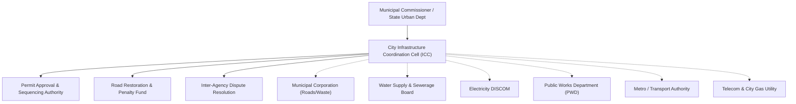

# CitySync — Digital Platform for Inter-Departmental Cooperation

> **"One Platform. One City. No More Digging in the Dark."**  
> *Unified data sharing, joint planning, and coordinated execution of urban infrastructure projects across city agencies.*

---

## 📌 Executive Summary

Indian cities are governed by a patchwork of parastatal agencies and line departments — municipal corporations, water boards, electricity DISCOMs, PWDs, development authorities, metro rail corporations, and gas or telecom operators. Each agency independently plans, budgets, and executes civil infrastructure projects.

This fragmentation creates severe information asymmetry and results in the chronic **"dig–repair–dig" cycle**:
* A municipal corporation resurfaces an arterial road.
* Two months later, the gas company cuts open the road for pipeline installation.
* Three months after that, the water board digs the same corridor to fix or lay a pipeline main.
* The road is left patched, uneven, structurally compromised, and taxpayer funds are re-incurred.

**CitySync** is a unified digital governance platform that breaks departmental silos. It acts as an authoritative coordination layer above all municipal agencies, providing shared GIS visibility, automated conflict detection, unified project scheduling, cross-department resource sharing, and machine learning-powered risk prediction.

---

## 🏙️ Key Stakeholders & Implementing Agencies

| Agency | Primary Mandate |
|---|---|
| **Municipal Corporation (ULB)** | City roads, storm-water drainage, waste management, public buildings |
| **Water Supply & Sewerage Board** | Underground potable pipelines, sewer mains, pumping stations |
| **Electricity DISCOM** | Overhead/underground power cabling, transformer installations |
| **Public Works Department (PWD)** | Arterial transit corridors, flyovers, state highways |
| **Metro Rail / Transport Authority** | Mass transit viaducts, stations, multi-modal interchanges |
| **Gas & Telecom Operators** | City gas distribution pipelines, optical fiber underground ducting |
| **Development Authority / Town Planning** | Master plan compliance, land use zones, right-of-way permissions |

---

## 🚀 Key Website Features & Capabilities

### 1. 🗺️ Common GIS Map & Spatial Project Registry
* **Live Interactive Map:** Integrated with Leaflet / OpenStreetMap, displaying all active, proposed, and ongoing civil works across the city.
* **Geo-Tagged Projects:** Every project is registered with precise coordinates (latitude & longitude), affected street address, administrative ward/zone, and buffer zone radius.
* **Filterable GIS Layers:** Filter infrastructure projects by department, project category (roadwork, water/sewage, power, telecom, transit), timeline status, and priority.

### 2. ⚡ Automated Spatial & Temporal Conflict Detection Engine
* **Double-Layer Overlap Detection:** Automatically checks whenever a project is created or updated:
  * **Temporal Overlap:** Identifies if two projects share overlapping dates ($Start_A \le End_B \land End_A \ge Start_B$).
  * **Spatial Overlap:** Uses the **Haversine formula** to measure proximity. Any overlapping corridor or projects within a 500-meter buffer radius are flagged.
* **Conflict Severity Classification:** Categorizes conflicts into *Low*, *Medium*, *High*, and *Critical* based on location overlap, road category, and project priority.
* **Pre-Permit Alerts:** Flags potential collisions **before** excavation permits are granted, preventing on-site clashes.

### 3. 📅 Unified Project Scheduling & Master Timeline (Gantt View)
* **Master City Timeline:** Visualizes citywide project schedules in an intuitive timeline/Gantt format so department heads can see who is working where and when.
* **Unified Phasing Engine:** Recommends the logical sequencing of works on shared corridors:
  $$\text{Sub-surface Utilities (Water/Gas/Telecom/Power)} \longrightarrow \text{Base Layer Compaction} \longrightarrow \text{Final Surface Paving}$$
* **Moratorium Enforcement:** Automatically enforces a 2-to-3 year "No-Dig Moratorium" on newly carpeted roads.

### 4. 🚜 Cross-Department Resource & Equipment Sharing
* **Shared Equipment Pool:** Maintains a real-time searchable inventory of heavy machinery (excavators, asphalt compactors, micro-trenchers, suction trucks, mobile generators) and technical specialists.
* **Booking & Requisition Workflow:** Departments can request idle machinery from other agencies, approve/reject transfers, and track availability, cutting down idle equipment costs.

### 5. 🤖 Machine Learning Delay & Risk Prediction
* **Delay Prediction Engine:** Evaluates project parameters (budget, duration, contractor category, season/monsoon factors, historical department performance) to forecast potential timeline delays.
* **Risk Classification:** Identifies high-risk infrastructure ventures early, allowing administrators to allocate additional oversight or buffer periods.

### 6. 🔐 Multi-Tier Role-Based Access Control (RBAC) & Security
* **Hierarchical Roles:**
  * **City Admin (ICC / Municipal Commissioner):** Citywide visibility, statutory permit approval, conflict resolution enforcement, and audit logs.
  * **Department Head:** Project creation, budget oversight, resource approvals, and inter-department coordination.
  * **Field Officer / Engineer:** Milestone progress reporting, on-site status updates, and emergency repair requests.
* **Secure Authentication:** JSON Web Token (JWT) stateless auth paired with bcrypt password hashing and route-level authorization middleware.

### 7. 🔔 Real-Time Notifications & Immutable Audit Logging
* **Multi-Channel Alerts:** Automatically notifies relevant departments when an overlapping project is registered, a permit is pending, or a deadline is approaching.
* **Comprehensive Audit Trail:** Logs every action (project modifications, permit approvals, conflict resolutions, resource transfers) with timestamps and user identities for complete accountability.

---

## 🛡️ The 5-Part "Dig-Later" Policy Framework

When a department must install infrastructure on a recently paved road, CitySync enforces a five-step structured governance mechanism:

```
[1. Declare Future Needs] ──> [2. Build Shared Ducts] ──> [3. No-Dig Moratorium] ──> [4. Trenchless Tech] ──> [5. Penalty Fund]
```

1. **Declare Future Needs:** All agencies submit planned underground utility requirements for a 3–5 year horizon prior to new road construction. Silence is legally recorded as "No Objection".
2. **Build Shared Common Ducts:** Conduits, utility ducts, and access chambers are co-laid during road creation so future fiber or cables can be pulled through without cutting asphalt.
3. **No-Dig Moratorium:** Newly completed roads receive a protected 2-to-3 year moratorium preventing non-emergency open trenching.
4. **Trenchless Technology Mandate:** If unpredicted work is unavoidable, contractors must use Horizontal Directional Drilling (HDD) or micro-trenching rather than surface cuts.
5. **Road Restoration Fund & Penalties:** Unauthorized excavation incurs severe financial penalties and full restoration surcharges, deposited into a dedicated municipal repair fund.

---

## 🏛️ Institutional Governance Layer

Software alone cannot compel independent agencies to collaborate. CitySync is designed to operate under an empowered statutory body:



---

## 👥 Module Distribution & Team Contributions

| Member | Focus Area | Technology | Key Deliverables |
|---|---|---|---|
| **Member 1** | Frontend & Dashboard | React.js, CSS, Charts | Main dashboard, navigation, interactive analytics, timeline UI, project tables. |
| **Member 2** | Authentication & Department Management | Node.js, Express, MongoDB, JWT | User auth (signup/login), RBAC middleware, department directory, user-to-dept assignment. |
| **Member 3** | Project Management & Scheduling | Node.js, Express, Mongoose, Haversine | Project CRUD registry, spatial & temporal conflict detection engine, timeline/Gantt endpoints, conflict resolution workflow. |
| **Member 4** | Machine Learning | Python, Scikit-learn, FastAPI / Flask | ML delay prediction model, risk classification pipeline, REST endpoint integration. |
| **Member 5** | Resource Sharing & Notifications | Node.js, Express, MongoDB | Equipment/machinery inventory, inter-agency request workflow, notifications, audit log records. |
| **Member 6** | Database, GIS & System Integration | MongoDB, Leaflet, OSM, Postman | Shared database schemas, geospatial indexing, Leaflet map integration, end-to-end integration & deployment. |

---

## 💻 Tech Stack

| Layer | Technologies |
|---|---|
| **Frontend** | React.js, Modern Responsive Vanilla CSS, Leaflet.js / OpenStreetMap, Lucide Icons |
| **Backend** | Node.js, Express.js |
| **Database** | MongoDB Atlas, Mongoose ODM |
| **Authentication** | JSON Web Tokens (JWT), Bcrypt.js, Custom Role Middleware |
| **Machine Learning** | Python 3, Scikit-learn, Pandas, NumPy |
| **Tooling & Testing** | Git / GitHub, Postman, Nodemon, Dotenv |

---

## 📂 Project Structure

```text
CitySync/
├── backend/
│   ├── src/
│   │   ├── config/
│   │   │   └── db.js                 # MongoDB connection
│   │   ├── controllers/
│   │   │   ├── authController.js         # Member 2: Auth
│   │   │   ├── departmentController.js   # Member 2: Departments
│   │   │   ├── userController.js         # Member 2: Users
│   │   │   ├── projectController.js      # Member 3: Project CRUD & Scheduling
│   │   │   ├── conflictController.js     # Member 3: Conflict Detection & Resolution
│   │   │   ├── resourceController.js     # Member 5: Shared Inventory
│   │   │   ├── requestController.js      # Member 5: Requisitions
│   │   │   ├── notificationController.js # Member 5: Notifications
│   │   │   └── auditController.js        # Member 5: Audit Logs
│   │   ├── middleware/
│   │   │   ├── authMiddleware.js         # JWT verification
│   │   │   └── roleMiddleware.js         # RBAC access protection
│   │   ├── models/
│   │   │   ├── User.js                   # User schema
│   │   │   ├── Department.js             # Department schema
│   │   │   ├── Project.js                # Member 3: Project schema
│   │   │   ├── Conflict.js               # Member 3: Conflict schema
│   │   │   ├── Resource.js               # Member 5: Resource inventory
│   │   │   ├── ResourceRequest.js        # Member 5: Request lifecycle
│   │   │   ├── Notification.js           # Member 5: Alerts
│   │   │   └── AuditLog.js               # Member 5: Activity audit
│   │   ├── routes/
│   │   │   ├── authRoutes.js
│   │   │   ├── departmentRoutes.js
│   │   │   ├── userRoutes.js
│   │   │   ├── projectRoutes.js
│   │   │   ├── conflictRoutes.js
│   │   │   ├── resourceRoutes.js
│   │   │   ├── requestRoutes.js
│   │   │   ├── notificationRoutes.js
│   │   │   └── auditRoutes.js
│   │   ├── utils/
│   │   │   ├── conflictDetector.js       # Member 3: Haversine & temporal engine
│   │   │   └── notifyAudit.js            # Member 5: Notification & audit helper
│   │   └── app.js                        # Express app & route mounting
│   ├── server.js                         # Server entry point
│   ├── package.json
│   └── README.md                         # Backend-specific documentation
├── frontend/
│   ├── src/                              # React frontend source files
│   └── index.html
├── Interdepartmental_Cooperation_Platform.pptx    # Capstone presentation
├── Interdepartmental_Cooperation_Platform_Report.pdf # Capstone project report
└── README.md                             # Global project documentation
```

---

## 🛠️ Installation & Setup

### Prerequisites
* [Node.js](https://nodejs.org/) (v16 or higher)
* [Git](https://git-scm.com/)
* [MongoDB Atlas](https://www.mongodb.com/cloud/atlas) account or local MongoDB instance

### 1. Clone the Repository
```bash
git clone https://github.com/sarthak-agnihotri/CitySync.git
cd CitySync
```

### 2. Configure Backend Environment
Navigate to `backend` and install dependencies:
```bash
cd backend
npm install
```

Create a `.env` file in the `backend/` directory:
```env
PORT=5000
MONGO_URI=your_mongodb_connection_string
JWT_SECRET=your_jwt_secret_key
JWT_EXPIRES_IN=1d
```

Start the backend development server:
```bash
npm run dev
```
The backend API will run on `http://localhost:5000`.

### 3. Run Frontend
Navigate to `frontend` and start the UI:
```bash
cd ../frontend
npm install
npm run dev
```

---

## 🔗 Key API Endpoints Overview

| Service | Method | Route | Description |
|---|---|---|---|
| **Auth** | `POST` | `/api/auth/register` | Register new city officer / administrator |
| **Auth** | `POST` | `/api/auth/login` | Authenticate user and receive JWT |
| **Departments** | `GET` | `/api/departments` | List all registered city departments |
| **Projects** | `POST` | `/api/projects` | Register a project & run automated conflict check |
| **Projects** | `GET` | `/api/projects` | Filter projects by status, department, and zone |
| **Timeline** | `GET` | `/api/projects/schedule/timeline` | Get unified scheduling data for Gantt view |
| **Conflicts** | `GET` | `/api/conflicts` | List flagged spatial & date conflicts |
| **Conflicts** | `PUT` | `/api/conflicts/:id/resolve` | Coordinate & mark conflict as resolved |
| **Resources** | `GET` | `/api/resources` | List shared equipment & machinery |
| **Requisitions**| `POST` | `/api/requests` | Request shared equipment from another department |
| **Audit Logs** | `GET` | `/api/audit` | View immutable action history across the city |

---

## 🌿 Git Collaboration Rules

To ensure smooth multi-member development:
1. **Never commit directly to `main`**: Always work on your designated feature branch (e.g. `feature/member-3-projects`).
2. **Pull before starting work**: Keep your branch up to date:
   ```bash
   git checkout main
   git pull origin main
   git checkout feature/your-branch
   git merge main
   ```
3. **Meaningful Commits**: Use descriptive messages such as:
   `git commit -m "feat(conflict-engine): implement haversine distance calculation"`
4. **Pull Requests (PR)**: Push your branch and open a PR on GitHub for code review before merging into `main`.

---

## 📄 License & Academic Attribution
Developed as part of the **Urban Governance Capstone Project — Urban Planning & Architecture**.  
*CitySync: Streamlining city operations through unified digital cooperation.*
