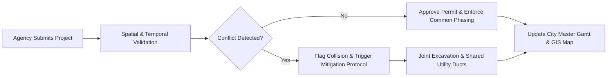
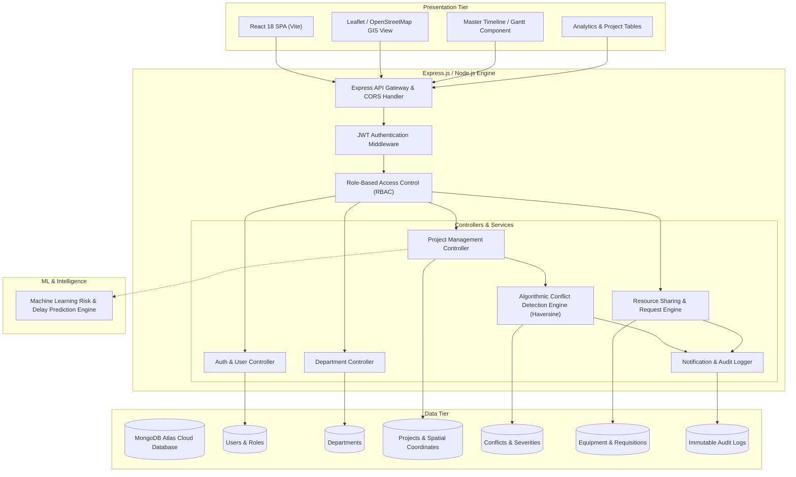
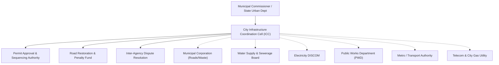

# CitySync — Digital Platform for Inter-Departmental Cooperation

<p align="center">
  
  
  
  
  
  
  
</p>

> **"One Platform. One City. No More Digging in the Dark."**  
> *A unified digital governance and spatial coordination platform designed to end the chronic "dig–repair–dig" cycle across municipal corporations, utility providers, and transit authorities.*

---

## 📑 Table of Contents

- [Urban Problem Statement](#-urban-problem-statement)
- [The CitySync Solution](#-the-citysync-solution)
- [Key Stakeholders & Implementing Agencies](#-key-stakeholders--implementing-agencies)
- [Core Platform Capabilities](#-core-platform-capabilities)
  - [1. GIS Spatial Registry](#1--common-gis-map--spatial-project-registry)
  - [2. Algorithmic Conflict Engine](#2--spatial--temporal-conflict-detection-engine)
  - [3. Master City Scheduling](#3--unified-project-scheduling--master-timeline-gantt-view)
  - [4. Inter-Agency Resource Sharing](#4--cross-department-resource--equipment-sharing)
  - [5. Machine Learning Delay Prediction](#5--machine-learning-delay--risk-prediction)
  - [6. Role-Based Access Control (RBAC)](#6--multi-tier-role-based-access-control-rbac)
  - [7. Audit Logging & Alerts](#7--real-time-notifications--immutable-audit-logging)
- [System Architecture & Data Flow](#-system-architecture)
- [Technology Stack](#-technology-stack)
- [Repository File Structure](#-repository-file-structure)
- [Quickstart & Installation Guide](#-installation--setup-guide)
- [Pre-Seeded Demo Credentials](#-pre-seeded-demo-accounts)
- [REST API Reference](#-rest-api-reference)
- [Role & Permissions Matrix](#-role-based-permissions-matrix)
- [The 5-Part "Dig-Later" Policy Framework](#-the-5-part-dig-later-policy-framework)
- [Institutional Governance Model](#-institutional-governance-model)
- [Team Roles & Module Distribution](#-module-distribution--team-contributions)
- [Git Branching & Collaboration Workflow](#-git-collaboration-rules)
- [Project Roadmap](#-roadmap--future-horizons)
- [License & Academic Attribution](#-license--academic-attribution)

---

## 🏙️ Urban Problem Statement

Modern cities are governed by a patchwork of parastatal agencies and line departments — municipal corporations, water supply & sewerage boards, electricity distribution companies (DISCOMs), public works departments (PWD), transit authorities, and telecom/gas concessionaires. Each agency operates in departmental isolation: planning, budgeting, and executing civil infrastructure projects on separate timelines without visibility into neighboring initiatives.

This fragmentation creates severe information asymmetry and causes the ubiquitous **"dig–repair–dig" cycle**:

```
[1. Municipal Corp] ────> Resurfaces arterial roadway with fresh bituminous asphalt
         │
         ▼ (2 months later)
[2. Gas Utility]    ────> Cuts open fresh road to install underground city gas pipelines
         │
         ▼ (3 months later)
[3. Water Board]    ────> Digs open the same corridor to replace a leaking water trunk line
         │
         ▼
[Resulting Crisis]  ────> Road is structurally compromised, potholes proliferate, 
                          public tax funds are wasted repeatedly, traffic gridlock ensues.
```

### Quantifiable Consequences of Uncoordinated Digging:
* **Taxpayer Waste:** Municipalities spend millions repaving corridors that are excavated shortly thereafter.
* **Economic Stagnation:** Repeated roadworks trigger severe traffic congestion, transit delays, and business disruption.
* **Environmental & Public Health Hazards:** Continuous unpaved trenches cause airborne particulate pollution ($PM_{2.5}$ & $PM_{10}$) and water logging during monsoons.
* **Accidental Utility Outages:** Excavators from one agency regularly sever subterranean cables or water mains belonging to another agency due to missing spatial visibility.

---

## 💡 The CitySync Solution

**CitySync** provides an authoritative, digital-first coordination layer above all municipal agencies. By combining **Geographic Information Systems (GIS)**, an **algorithmic conflict detection engine**, and **shared resource workflows**, CitySync eliminates departmental blind spots before heavy machinery ever breaks ground.



---

## 🏛️ Key Stakeholders & Implementing Agencies

| Agency | Domain & Primary Responsibilities | Typical Sub-Surface Impact |
|---|---|---|
| **Municipal Corporation (ULB)** | City roads, storm-water drainage networks, street lighting, waste infrastructure | Paving, open drains, culverts |
| **Water Supply & Sewerage Board** | High-pressure potable trunk lines, wastewater collectors, sewer mains | Deep trenches ($1.5\text{m} - 3\text{m}$ depth) |
| **Electricity DISCOM** | High-tension/low-tension cabling, underground conduits, distribution transformers | Mid-depth trenches ($0.8\text{m} - 1.2\text{m}$) |
| **Public Works Department (PWD)** | Transit corridors, arterial expressways, flyovers, grade separators | Heavy pavement excavation, foundation piling |
| **Metro Rail / Transport Authority**| Mass transit viaducts, subterranean stations, multi-modal interchanges | Deep tunneling, right-of-way diversions |
| **City Gas & Telecom Utilities** | Piped natural gas (PNG) steel/MDPE lines, optical fiber conduit ducting | Horizontal drilling, micro-trenching |
| **City Infrastructure Coordination Cell (ICC)** | Statutory arbitrating authority empowered to sequence civil projects | Permitting, moratorium enforcement, dispute resolution |

---

## 🚀 Core Platform Capabilities

### 1. 🗺️ Common GIS Map & Spatial Project Registry
* **Centralized Spatial Repository:** Replaces fragmented spreadsheets with a single interactive map powered by **Leaflet.js** and **OpenStreetMap**.
* **Precise Geotagging:** Every infrastructure proposal requires geographical coordinates (latitude & longitude), affected street address, administrative ward/zone, and excavation radius buffer.
* **Dynamic Multi-Layer Filters:** Filter city projects in real time by department, category (roadwork, water/sewage, power, telecom, transit), timeline status, and priority grade.

### 2. ⚡ Spatial & Temporal Conflict Detection Engine
CitySync features a dual-layer algorithmic conflict detection engine that executes automatically upon project creation and updates:

#### Mathematical Formulation:
1. **Temporal Overlap:**  
   Two projects $A$ and $B$ collide temporally if and only if their active execution windows intersect:
   $$\text{Temporal Collision} \iff (\text{Start}_A \le \text{End}_B) \land (\text{End}_A \ge \text{Start}_B)$$

2. **Spatial Proximity (Haversine Formula):**  
   The platform computes the great-circle surface distance $d$ between project locations $(lat_1, lon_1)$ and $(lat_2, lon_2)$:
   $$a = \sin^2\left(\frac{\Delta \phi}{2}\right) + \cos(\phi_1) \cdot \cos(\phi_2) \cdot \sin^2\left(\frac{\Delta \lambda}{2}\right)$$
   $$c = 2 \cdot \text{atan2}\left(\sqrt{a}, \sqrt{1-a}\right)$$
   $$d = R \cdot c \quad (\text{where Earth radius } R = 6,371,000\text{ meters})$$

3. **Conflict Severity Grading:**
   * 🔴 **Critical:** $d \le 150\text{ meters}$ with overlapping dates OR either project is classified as "critical priority". Requires mandatory joint coordination review.
   * 🟠 **High:** $150\text{m} < d \le 500\text{ meters}$ with overlapping dates. Road corridor capacity or detour clashes.
   * 🟡 **Medium:** Overlapping dates within the same administrative ward/zone.
   * 🟢 **Low:** Adjacent timeline overlaps outside immediate impact buffers.

### 3. 📅 Unified Project Scheduling & Master Timeline (Gantt View)
* **Citywide Unified Master Gantt:** Visualizes all department schedules on a single interactive timeline so administrators can identify congestion bottlenecks months ahead.
* **Algorithmic Utility Sequencing:** Recommends the only logical engineering hierarchy for shared corridors:
  $$\text{Deep Subsurface Utilities (Water / Sewer)} \longrightarrow \text{Shallow Utilities (Gas / Power / Telecom)} \longrightarrow \text{Sub-base Compaction} \longrightarrow \text{Final Bituminous Paving}$$
* **No-Dig Moratorium Tracking:** Enforces a protected 2-to-3 year "No-Dig" freeze on freshly carpeted road surfaces, rejecting non-emergency excavation permits.

### 4. 🚜 Cross-Department Resource & Equipment Sharing
* **Shared Heavy Machinery Pool:** Real-time searchable inventory of expensive, specialized machinery (hydraulic excavators, asphalt pavers, micro-trenchers, suction tankers, mobile generators) across departments.
* **Inter-Agency Requisitions:** Departments can request idle equipment from other agencies, reducing capital expenditure and machine downtime.
* **Transfer Lifecycle Tracking:** Full approval workflow (`pending` $\rightarrow$ `approved` $\rightarrow$ `in-use` $\rightarrow$ `returned`) with automatic quantity incrementing and decrementing.

### 5. 🤖 Machine Learning Delay & Risk Prediction
* **Predictive Delay Modeling:** Evaluates project parameters including planned duration, estimated budget, assigned contractor tier, monsoon weather risk coefficients, and department historical efficiency to forecast project completion delays.
* **Risk Categorization:** Flags high-risk projects early, prompting municipal commissioners to allocate contingency buffers or additional supervisory oversight.

### 6. 🔐 Multi-Tier Role-Based Access Control (RBAC)
* **City Administrator (Commissioner / ICC):** Full citywide visibility, permit issuance, conflict resolution override, user management, and audit log inspection.
* **Department Head:** Project creation, budget modification, resource request approvals, and inter-department coordination.
* **Field Officer / Site Engineer:** On-site progress updates, completion reporting, and emergency requisition requests.
* **Stateless Security:** Built with signed JSON Web Tokens (JWT) containing cryptographic user payloads, paired with salted Bcrypt password hashing.

### 7. 🔔 Real-Time Notifications & Immutable Audit Logging
* **Automated Collision Warnings:** Instant system alerts generated and dispatched whenever a newly submitted project conflicts with an existing schedule.
* **Immutable Audit Trail:** Chronological, tamper-evident log documenting every project creation, status update, conflict resolution, and resource transfer with timestamps and user identifiers.

---

## 🏗️ System Architecture

CitySync is built on an enterprise 3-tier decoupled architecture:



---

## 💻 Technology Stack

| Layer | Technology | Version | Purpose |
|---|---|---|---|
| **Frontend Framework** | React.js | `^18.3.1` | Component-driven declarative user interface |
| **Build Tool & Dev Server** | Vite | `^6.0.1` | Ultra-fast HMR and optimized production bundling |
| **Routing** | React Router DOM | `^6.28.0` | Client-side routing, protected navigation flows |
| **Styling & Design** | Vanilla CSS (CSS3) | — | Custom, high-performance responsive styling |
| **Mapping & GIS** | Leaflet.js / OpenStreetMap | — | Interactive spatial map layer and project plotting |
| **Backend Runtime** | Node.js | `>= 18.0.0` | Scalable asynchronous JavaScript server environment |
| **Web Framework** | Express.js | `^5.3.0` | Robust RESTful routing and middleware pipeline |
| **Database** | MongoDB Atlas / Mongoose | `^9.11.2` | Document database with native geospatial query support |
| **Authentication** | JSON Web Tokens (`jsonwebtoken`) | `^9.0.3` | Stateless token authorization across all API routes |
| **Password Encryption**| `bcryptjs` | `^3.0.3` | Salted hashing for secure credential persistence |
| **Environment Config** | `dotenv` | `^18.0.8` | Secure zero-exposure environment variable management |
| **CORS Middleware** | `cors` | `^2.8.6` | Cross-origin resource sharing between client & server |
| **ML Engine (Planned)**| Python 3 / Scikit-Learn | `3.10+` | Project delay prediction and risk classification |

---

## 📂 Repository File Structure

```text
CitySync/
├── backend/
│   ├── src/
│   │   ├── config/
│   │   │   └── db.js                 # MongoDB connection & lifecycle handling
│   │   ├── controllers/
│   │   │   ├── authController.js         # User registration, login & token issuance
│   │   │   ├── departmentController.js   # Department directory & management
│   │   │   ├── userController.js         # User administration & role assignment
│   │   │   ├── projectController.js      # Project CRUD, filtering & timeline schedules
│   │   │   ├── conflictController.js     # Conflict listing, inspection & resolution
│   │   │   ├── resourceController.js     # Equipment inventory management
│   │   │   ├── requestController.js      # Resource borrowing & requisition lifecycle
│   │   │   ├── notificationController.js # Multi-department alert dispatching
│   │   │   └── auditController.js        # Comprehensive action audit log retrieval
│   │   ├── middleware/
│   │   │   ├── authMiddleware.js         # JWT verification & request user injection
│   │   │   └── roleMiddleware.js         # RBAC route protection based on user role
│   │   ├── models/
│   │   │   ├── User.js                   # User credentials, roles & department refs
│   │   │   ├── Department.js             # Municipal agency registry & contact points
│   │   │   ├── Project.js                # Project specs, coordinates, budget & status
│   │   │   ├── Conflict.js               # Flagged spatial/temporal collisions
│   │   │   ├── Resource.js               # Heavy machinery & shared equipment pool
│   │   │   ├── ResourceRequest.js        # Requisition records & approval states
│   │   │   ├── Notification.js           # Real-time alert messages
│   │   │   └── AuditLog.js               # Immutable record of system modifications
│   │   ├── routes/
│   │   │   ├── authRoutes.js             # /api/auth endpoints
│   │   │   ├── departmentRoutes.js       # /api/departments endpoints
│   │   │   ├── userRoutes.js             # /api/users endpoints
│   │   │   ├── projectRoutes.js          # /api/projects endpoints
│   │   │   ├── conflictRoutes.js         # /api/conflicts endpoints
│   │   │   ├── resourceRoutes.js         # /api/resources endpoints
│   │   │   ├── requestRoutes.js          # /api/requests endpoints
│   │   │   ├── notificationRoutes.js     # /api/notifications endpoints
│   │   │   └── auditRoutes.js            # /api/audit endpoints
│   │   ├── utils/
│   │   │   ├── conflictDetector.js       # Haversine distance & temporal overlap engine
│   │   │   └── notifyAudit.js            # Cross-cutting notification & audit helper
│   │   └── app.js                        # Express server assembly & route registration
│   ├── seed.js                           # Automated test data seeder with sample conflicts
│   ├── server.js                         # Application entry point & port listener
│   ├── package.json                      # Backend dependencies & runtime scripts
│   └── README.md                         # Backend module documentation
│
├── frontend/
│   ├── src/
│   │   ├── api/                          # Axios/Fetch API client abstractions
│   │   ├── components/                   # Reusable UI elements (Navbar, Cards, Modals)
│   │   ├── context/                      # React context for Auth & Global state
│   │   ├── pages/                        # Screen views (Dashboard, Projects, Map, Gantt)
│   │   │   ├── auth/                     # Login & Register views
│   │   │   ├── dashboard/                # Central executive overview
│   │   │   ├── departments/              # Department directory
│   │   │   ├── resources/                # Equipment inventory & requisition forms
│   │   │   ├── notifications/            # Alert inbox
│   │   │   └── audit/                    # Immutable audit trail
│   │   ├── styles/                       # Modular CSS stylesheets
│   │   ├── App.jsx                       # Root React router and view structure
│   │   └── main.jsx                      # DOM mount entry point
│   ├── index.html                        # HTML5 shell
│   ├── vite.config.js                    # Vite configuration with /api backend proxy
│   └── package.json                      # Frontend dependencies & build scripts
│
├── Interdepartmental_Cooperation_Platform.pptx    # Capstone presentation deck
├── Interdepartmental_Cooperation_Platform_Report.pdf # Capstone academic report
├── roadmap.md                            # Detailed developer implementation roadmap
└── README.md                             # Master project documentation
```

---

## 🛠️ Installation & Setup Guide

### System Prerequisites
Ensure the following tools are installed on your workstation:
* **Node.js:** v18.0.0 or higher ([Download](https://nodejs.org/))
* **Git:** Latest version ([Download](https://git-scm.com/))
* **MongoDB:** A running local MongoDB instance or a free [MongoDB Atlas](https://www.mongodb.com/cloud/atlas) cluster URL

---

### Step 1: Clone the Repository
```bash
git clone https://github.com/sarthak-agnihotri/CitySync.git
cd CitySync
```

---

### Step 2: Configure and Seed the Backend

1. Navigate to the `backend/` directory:
   ```bash
   cd backend
   npm install
   ```

2. Create a `.env` configuration file inside `backend/`:
   ```env
   PORT=5000
   MONGO_URI=mongodb://localhost:27017/Citysync
   JWT_SECRET=your_super_secret_jwt_key_citysync_2026
   JWT_EXPIRES_IN=1d
   ```
   *(If using MongoDB Atlas, replace `MONGO_URI` with your Atlas connection string).*

3. **Seed Database with Realistic Municipal Data:**
   Run the automated database seeder to populate sample departments, pre-configured roles, equipment, and a live spatial conflict:
   ```bash
   node seed.js
   ```
   *Output confirmation:*
   ```text
   🌱 CitySync Database Seeded Successfully!
   Detected and logged 1 conflict(s) between seed projects.
   ```

4. **Launch the Backend API Server:**
   ```bash
   npm run dev
   ```
   The backend will start on **`http://localhost:5000`**. You can verify server status at `http://localhost:5000/api/health`.

---

### Step 3: Run the Frontend Client

1. Open a new terminal window and navigate to `frontend/`:
   ```bash
   cd frontend
   npm install
   ```

2. **Launch the Vite Development Server:**
   ```bash
   npm run dev
   ```
   The client application will start on **`http://localhost:5173`** (or `http://127.0.0.1:5173`).  
   *(Vite automatically proxies all `/api/*` network requests to `http://localhost:5000` via [vite.config.js](file:///e:/Capstone/CitySync/frontend/vite.config.js)).*

---

## 👥 Pre-Seeded Demo Accounts

The database seeder provisions four ready-to-test accounts representing each administrative tier:

| Role | Email | Password | Department | Recommended Test Scenarios |
|---|---|---|---|---|
| **City Administrator** | `admin@citysync.gov` | `Admin@1234` | All Municipalities | Review citywide dashboard, approve/override flagged conflicts, inspect immutable audit logs |
| **PWD Department Head** | `pwd_head@citysync.gov` | `Head@1234` | Public Works Dept | Create roadwork projects, check conflict detection engine, request machinery from other agencies |
| **Water Board Head** | `water_head@citysync.gov`| `Head@1234` | Water Supply & Sewerage | Approve inter-agency equipment borrowing, review overlapping corridor warnings |
| **Field Officer** | `officer@citysync.gov` | `Officer@1234`| Public Works Dept | Submit ground milestone updates, report project completion status |

---

## 🔗 REST API Reference

All protected routes require a Bearer token in the request header:  
`Authorization: Bearer <your_jwt_token>`

### 1. Authentication & Users
| Method | Endpoint | Auth | Allowed Roles | Description |
|---|---|---|---|---|
| `POST` | `/api/auth/register` | Public | Anyone | Register a new city officer or department head |
| `POST` | `/api/auth/login` | Public | Anyone | Authenticate with email/password; returns JWT |
| `GET` | `/api/auth/me` | Bearer | All Authenticated | Get current authenticated user profile |
| `GET` | `/api/users` | Bearer | `city_admin` | View all registered accounts across agencies |
| `PUT` | `/api/users/:id/department` | Bearer | `city_admin` | Assign a user to a specific municipal department |

### 2. Departments
| Method | Endpoint | Auth | Allowed Roles | Description |
|---|---|---|---|---|
| `GET` | `/api/departments` | Bearer | All Authenticated | List all registered city departments and contact details |
| `POST` | `/api/departments` | Bearer | `city_admin` | Register a new municipal agency into the system |
| `GET` | `/api/departments/:id` | Bearer | All Authenticated | Fetch department details by ID |

### 3. Project Management & Scheduling (Core Engine)
| Method | Endpoint | Auth | Allowed Roles | Description |
|---|---|---|---|---|
| `GET` | `/api/projects` | Bearer | All Authenticated | List projects with filtering (`status`, `department`, `zone`, `category`) |
| `GET` | `/api/projects/:id` | Bearer | All Authenticated | Fetch full project dossier and geospatial coordinates |
| `POST` | `/api/projects` | Bearer | `city_admin`, `department_head`, `officer` | Register new project & **automatically trigger conflict detection** |
| `PUT` | `/api/projects/:id` | Bearer | `city_admin`, `department_head` | Update project parameters, budget, dates or status |
| `DELETE`| `/api/projects/:id` | Bearer | `city_admin`, `department_head` | Soft delete / remove project from active registry |
| `GET` | `/api/projects/schedule/timeline` | Bearer | All Authenticated | Get grouped project schedule data formatted for Gantt view |
| `GET` | `/api/projects/schedule/calendar` | Bearer | All Authenticated | Get monthly calendar view of active municipal excavations |

### 4. Conflict Detection & Resolution
| Method | Endpoint | Auth | Allowed Roles | Description |
|---|---|---|---|---|
| `GET` | `/api/conflicts` | Bearer | All Authenticated | List all detected spatial & temporal project collisions |
| `GET` | `/api/conflicts/:id` | Bearer | All Authenticated | View details of a specific conflict, distance & affected parties |
| `PUT` | `/api/conflicts/:id/resolve` | Bearer | `city_admin`, `department_head` | Record joint coordination notes and mark conflict resolved |

### 5. Shared Equipment & Requisitions
| Method | Endpoint | Auth | Allowed Roles | Description |
|---|---|---|---|---|
| `GET` | `/api/resources` | Bearer | All Authenticated | Browse available machinery pool with real-time stock |
| `POST` | `/api/resources` | Bearer | `city_admin`, `department_head` | Register new equipment into the shared departmental inventory |
| `POST` | `/api/requests` | Bearer | All Authenticated | Submit equipment borrowing requisition to another agency |
| `GET` | `/api/requests` | Bearer | All Authenticated | View sent and received resource borrowing requests |
| `PUT` | `/api/requests/:id/approve` | Bearer | `department_head` (Owner) | Approve resource requisition and reserve machinery |
| `PUT` | `/api/requests/:id/return` | Bearer | All Authenticated | Record equipment return and restore inventory count |

### 6. Notifications & Audit Logs
| Method | Endpoint | Auth | Allowed Roles | Description |
|---|---|---|---|---|
| `GET` | `/api/notifications` | Bearer | All Authenticated | Fetch personalized unread alerts and conflict warnings |
| `PUT` | `/api/notifications/:id/read`| Bearer | All Authenticated | Mark a notification as read |
| `GET` | `/api/audit` | Bearer | `city_admin` | Inspect immutable audit log history across all departments |
| `GET` | `/api/health` | Public | Anyone | Backend healthcheck and uptime ping |

---

## 🔐 Role-Based Permissions Matrix

| Platform Action | City Administrator (`city_admin`) | Department Head (`department_head`) | Field Officer (`officer`) |
|---|:---:|:---:|:---:|
| **View City GIS Map & Projects** | ✅ Full Access | ✅ Full Access | ✅ Full Access |
| **Create New Project** | ✅ Yes | ✅ Yes (Own Dept) | ✅ Yes (Assigned Zone) |
| **Modify Project Budget / Dates** | ✅ Yes | ✅ Yes (Own Dept) | ❌ Read Only |
| **Delete Project** | ✅ Yes | ✅ Yes (Own Dept) | ❌ Read Only |
| **Inspect Detected Conflicts** | ✅ Full Access | ✅ Involved Depts | ✅ View Only |
| **Resolve & Override Conflicts** | ✅ Authoritative | ✅ Bilateral Agreement | ❌ Read Only |
| **Add Equipment to Inventory** | ✅ Yes | ✅ Yes (Own Dept) | ❌ Read Only |
| **Borrow Shared Machinery** | ✅ Yes | ✅ Yes | ✅ Submit Requisition |
| **Approve Machinery Loan** | ✅ Yes | ✅ Yes (Owner Dept) | ❌ No |
| **Access System Audit Logs** | ✅ Full Audit Trail | ❌ No | ❌ No |
| **Manage Departments & Users** | ✅ Full Management | ❌ No | ❌ No |

---

## 🛡️ The 5-Part "Dig-Later" Policy Framework

To ensure that digital coordination is backed by rigorous civic enforcement, CitySync operationalizes the **5-Part Policy Framework**:

```
[1. Declare Future Needs] ──> [2. Build Shared Ducts] ──> [3. No-Dig Moratorium] ──> [4. Trenchless Tech] ──> [5. Penalty Fund]
```

1. **Declare Future Needs:** All utility agencies must submit their 3-to-5-year underground infrastructure capital plans onto CitySync prior to any road construction. Silence is legally recorded as "No Objection".
2. **Build Shared Common Ducts:** Standardized multi-utility conduits and access chambers are laid during initial road surfacing, allowing future fiber cables or pipes to be pulled through without cutting surface asphalt.
3. **No-Dig Moratorium:** Newly completed roads automatically receive a 2-to-3 year protected moratorium. Non-emergency open-trench cuts are rejected programmatically.
4. **Mandatory Trenchless Technology:** When unforeseen subsurface work is unavoidable, agencies are required to use **Horizontal Directional Drilling (HDD)** or micro-trenching instead of destructive open-trench excavation.
5. **Restoration Surcharge & Penalty Fund:** Unauthorized or uncoordinated road cuts incur punitive financial levies deposited into a dedicated municipal escrow fund for immediate surface restoration.

---

## 🏛️ Institutional Governance Model

Software works only when accompanied by statutory authority. CitySync is architected to operate under an empowered **City Infrastructure Coordination Cell (ICC)** chaired by the Municipal Commissioner:



---

## 👥 Module Distribution & Team Contributions

| Member | Focus Area | Technology | Key Deliverables & Responsibilities |
|---|---|---|---|
| **Member 1** | **Frontend & Dashboard** | React.js, CSS3, Charts | Built main dashboard UI, status cards, interactive analytics, timeline view, project tables, and API integration. |
| **Member 2** | **Authentication & Department Management** | Node.js, Express, MongoDB, JWT | Implemented user registration/login, Bcrypt hashing, JWT auth middleware, role-based access control, and department directory. |
| **Member 3** | **Project Management & Scheduling** | Node.js, Express, Mongoose, Haversine | **Core coordination engine:** Built project CRUD, double-layer conflict detection (spatial via Haversine + temporal overlap), unified timeline schedule, and resolution workflow. |
| **Member 4** | **Machine Learning** | Python, Scikit-learn, REST API | Developed ML delay prediction model and project risk classification pipeline to estimate project overrun probabilities. |
| **Member 5** | **Resource Sharing & Notifications** | Node.js, Express, MongoDB | Built shared equipment inventory, inter-agency requisition/approval workflows, real-time alert dispatching, and audit logging. |
| **Member 6** | **Database, GIS & System Integration** | MongoDB Atlas, Leaflet.js, OSM, Postman | Designed database schema and geospatial indexes, integrated Leaflet interactive map, seed datasets, and coordinated end-to-end testing. |

---

## 🌿 Git Collaboration Rules

To ensure a smooth, conflict-free multi-developer workflow on GitHub, follow this branch-based protocol:

### Golden Rules:
1. **Never commit or push directly to `main`:** The `main` branch is the protected production branch.
2. **Always develop on designated feature branches:**  
   * Format: `feature/<member-number>-<feature-name>` (e.g., `feature/member-3-conflict-engine`).
3. **Pull latest changes before starting a session:**
   ```bash
   git checkout main
   git pull origin main
   git checkout feature/your-branch
   git merge main
   ```
4. **Use Conventional Commit Messages:**
   * `feat: implement haversine conflict detection algorithm`
   * `fix: correct date overlap evaluation in project schedule`
   * `docs: update API documentation and setup instructions`
5. **Open Pull Requests (PR):** Push your branch to GitHub and create a PR targeting `main`. Await code review and validation before merging.

---

## 🗺️ Roadmap & Future Horizons

- [x] **Phase 1: Core MERN Architecture & Infrastructure (Current)**
  - [x] Multi-tier JWT Authentication & Role-Based Authorization
  - [x] Project Registry with Geotagged Coordinates
  - [x] Automated Spatial (Haversine) & Temporal Conflict Detection Engine
  - [x] Master City Gantt Timeline & Phasing Visualizer
  - [x] Shared Machinery Inventory & Requisition Workflow
  - [x] Real-time Alerts & Immutable Action Audit Trail
- [ ] **Phase 2: Advanced GIS & Predictive Analytics**
  - [ ] Polygons and multi-point road corridor routing on Leaflet map
  - [ ] Production integration of Python ML Delay Prediction microservice
  - [ ] Automated SMS / WhatsApp webhook alerts for field engineers
- [ ] **Phase 3: Public Transparency & Smart City IoT**
  - [ ] Public Citizen Portal: View upcoming roadworks, detour maps, and report unauthorized digging
  - [ ] IoT Ground Vibration & Acoustic Sensor ingestion to detect illegal unauthorized drilling in real time
  - [ ] Drone photogrammetry integration for post-resurfacing pavement quality verification

---

## 📄 License & Academic Attribution

Developed as a Capstone Project for **Urban Governance & Smart Infrastructure Systems**.  
Built with pride to modernize Indian municipal operations and eliminate wasteful urban excavation.

**CitySync** — *One Platform. One City. No More Digging in the Dark.*
